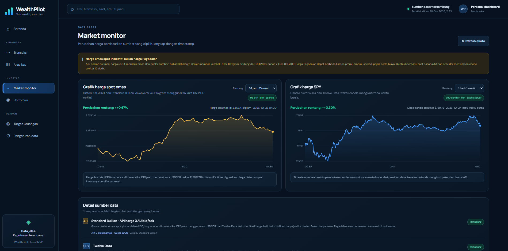

# WealthPilot — Dasbor Keuangan dan Investasi Pribadi

[](https://www.python.org/)
[](https://fastapi.tiangolo.com/)
[](https://www.sqlite.org/)
[](LICENSE)

**WealthPilot adalah dashboard keuangan dan investasi pribadi yang membantu memisahkan modal yang disetor, nilai pasar terkini, serta keuntungan/kerugian investasi.** Proyek local-first ini dirancang untuk membantu pengguna dengan pendapatan yang berubah-ubah memantau aset dan target finansial secara terstruktur.

> **Sumber data pasar versi v0.5.1:** quote emas spot global XAU bid/ask dari [Standard Bullion](https://standardbullion.com), dikonversi menjadi estimasi IDR/gram menggunakan kurs USD/IDR dari Twelve Data. Data SPY dan kurs USD/IDR menggunakan Twelve Data. Harga spot tersebut **bukan harga resmi Tabungan Emas Pegadaian**, bukan harga eksekusi Pluang, dan bukan jaminan harga buyback lokal. Aplikasi tidak terhubung ke akun pribadi Pegadaian/Pluang dan tidak mengeksekusi transaksi.

## Daftar isi

- [Tujuan proyek](#tujuan-proyek)
- [Fitur](#fitur)
- [Cara perhitungan](#cara-perhitungan)
- [Sumber dan kesegaran data](#sumber-dan-kesegaran-data)
- [Teknologi](#teknologi)
- [Instalasi di Windows](#instalasi-di-windows)
- [Menjalankan pengujian](#menjalankan-pengujian)
- [API yang tersedia](#api-yang-tersedia)
- [Keamanan dan privasi](#keamanan-dan-privasi)
- [Rencana pengembangan](#rencana-pengembangan)
- [Portofolio GitHub dan LinkedIn](#portofolio-github-dan-linkedin)
- [Pratinjau aplikasi](#pratinjau-aplikasi)

## Pratinjau aplikasi

Tangkapan layar berikut memperlihatkan halaman Market Monitor dari aplikasi lokal. Harga dan timestamp pada screenshot merupakan contoh kondisi saat pengambilan gambar; bukan quote real-time saat README dibaca.



*Market Monitor: histori harga emas spot, grafik SPY, timestamp candle, dan informasi sumber data.*

## Tujuan proyek

WealthPilot dikembangkan untuk menyelesaikan masalah pencatatan keuangan yang umum terjadi:

1. Modal yang disetorkan sering tercampur dengan kenaikan atau penurunan harga aset.
2. Harga pasar tidak berguna jika sumber dan waktu pembaruannya tidak jelas.
3. Pendapatan freelance yang tidak menentu membutuhkan alokasi yang fleksibel, bukan kewajiban investasi bulanan.
4. Pengguna perlu membuat target keuangan sendiri tanpa menu tetap seperti rumah atau pernikahan.
5. Harga yang tidak tersedia tidak boleh dianggap nol karena akan menghasilkan valuasi yang menyesatkan.

## Fitur

- **Ringkasan portofolio:** modal bersih, nilai portofolio, kas, P/L total, P/L terealisasi, dan P/L belum terealisasi.
- **Ledger transaksi:** setoran, penarikan, saldo awal aset, pembelian, penjualan, biaya, dividen/pendapatan kas, serta koreksi transaksi dengan validasi ulang urutan ledger.
- **Market Monitor emas spot:** quote bid/ask dari Standard Bullion, estimasi harga IDR per gram, timestamp, status kesegaran data, dan atribusi sumber.
- **SPY dan USD/IDR:** quote intraday melalui Twelve Data ketika API dan paket data mengizinkan.
- **Grafik SPY:** candle historis asli dari endpoint `time_series` Twelve Data dengan rentang 1 hari (1 menit), 5 hari (5 menit), 1 bulan (harian), dan 1 tahun (harian). Candle disimpan ke SQLite agar grafik tetap dapat ditinjau saat provider tidak tersedia, dengan status stale yang jelas.
- **Grafik emas spot:** memakai histori XAU dari provider; histori IDR merupakan estimasi karena dikonversi menggunakan kurs USD/IDR terkini, bukan kurs historis setiap titik.
- **Persentase kenaikan/penurunan:** SPY memakai perubahan provider atau rentang grafik; emas menampilkan perubahan yang disediakan feed spot. Perubahan harian, rentang grafik, dan P/L portofolio merupakan metrik yang berbeda.
- **Status data:** harga baru, tersimpan dari database, belum dikonfigurasi, atau tidak tersedia ditangani secara terpisah.
- **Grafik histori:** dibangun dari snapshot yang benar-benar tersimpan, bukan data contoh.
- **Target keuangan fleksibel:** pengguna dapat membuat, mengubah, dan menghapus target dengan nama, nominal, progres awal, catatan, dan tanggal target sendiri.
- **Arus kas dan komposisi portofolio.**
- **Ekspor riwayat transaksi ke CSV** untuk analisis spreadsheet, serta **cadangan JSON seluruh data lokal** (transaksi, target, snapshot Pegadaian, dan histori pasar).
- **Pengujian otomatis** untuk perhitungan, validasi transaksi, harga pasar, target, dan ekspor.
- **GitHub Actions** untuk menjalankan tes pada beberapa versi Python.

## Cara perhitungan

### Istilah utama

| Istilah | Makna |
|---|---|
| Modal bersih | Setoran eksternal + dasar modal saldo awal aset − penarikan eksternal. Setoran baru tidak dicatat sebagai keuntungan. |
| Saldo kas portofolio | Kas yang tercatat di ledger setelah pembelian, penjualan, dividen, setoran, dan penarikan. Ini bukan saldo semua rekening bank pengguna. |
| Nilai portofolio | Kas portofolio + estimasi nilai pasar semua aset yang bisa dinilai. |
| P/L belum terealisasi | Nilai pasar aset yang masih dimiliki − dasar modal aset yang tersisa. |
| P/L terealisasi | Hasil penjualan bersih dibandingkan dasar modal unit yang dijual, ditambah pendapatan dividen yang dicatat. |
| P/L total | Nilai portofolio − modal bersih, ketika valuasi semua kepemilikan lengkap. |

Dasar modal penjualan menggunakan metode rata-rata tertimbang. Biaya transaksi masuk ke dasar modal pembelian atau mengurangi hasil penjualan. Untuk emas, valuasi memakai bid spot yang dikonversi sebagai estimasi, bukan harga pencairan resmi Pegadaian atau harga eksekusi broker.

### Contoh satuan harga emas

Harga emas spot pada Market Monitor ditampilkan sebagai estimasi rupiah per gram. Untuk pencatatan investasi aktual, masukkan transaksi berdasarkan bukti transaksi dari penyedia tempat pembelian dilakukan; jangan memakai quote spot sebagai pengganti harga eksekusi.

## Sumber dan kesegaran data

### Emas spot XAU/USD

Harga emas berasal dari feed spot bid/ask [Standard Bullion](https://standardbullion.com). Ask adalah harga indikatif untuk membeli dari dealer sumber; bid adalah harga indikatif yang dealer sumber bayar ketika membeli dari pengguna. Harga USD per troy ounce dikonversi ke estimasi IDR/gram menggunakan kurs USD/IDR.

**Penting:** feed spot global bukan harga resmi Tabungan Emas Pegadaian/Tring!, bukan harga buyback lokal, dan bukan harga transaksi Pluang. Harga lokal dapat berbeda karena spread, premi produk, biaya, pajak, serta kebijakan penyedia. WealthPilot tidak login atau mengambil saldo dari akun Pegadaian maupun Pluang. Quote memakai polling/cache, bukan streaming tick-by-tick.

Grafik historis IDR menggunakan kurs USD/IDR terkini untuk mengonversi histori emas, bukan kurs historis pada setiap timestamp. Grafik IDR karena itu merupakan estimasi.

### SPY dan USD/IDR

Tambahkan API key pribadi pada file `.env` (cache quote SPY bawaan 60 detik, histori grafik 60 detik, dan FX 900 detik; sesuaikan dengan kuota paketmu):

```dotenv
TWELVE_DATA_API_KEY=masukkan_api_key_milikmu
SPY_CACHE_SECONDS=60
USDIDR_CACHE_SECONDS=900
SPY_QUOTE_INTERVAL=1min
USDIDR_QUOTE_INTERVAL=1min
SPY_SERIES_CACHE_SECONDS=60
```

WealthPilot menggunakan dua endpoint resmi Twelve Data: [`/quote`](https://twelvedata.com/docs#quote) untuk quote dan perubahan yang disediakan provider, serta [`/time_series`](https://twelvedata.com/docs#time-series) untuk candle historis yang benar-benar digambar pada grafik. Endpoint grafik lokal adalah `/api/market/series/SPY?range=1D`; parameter rentang yang didukung adalah `1D`, `5D`, `1M`, dan `1Y`. Tombol refresh meminta data baru melewati cache server. Grafik menampilkan jumlah candle, interval, perubahan dari candle awal ke candle akhir pada rentang yang dipilih, harga close candle terakhir, waktu candle, serta status respons.

**Data “real-time” bergantung pada paket, lisensi, bursa, hak tampilan, serta kuota API key kamu.** WealthPilot melakukan polling dan cache, bukan streaming tick-by-tick. Respons provider yang berhasil juga tidak otomatis berarti harganya live; periksa timestamp candle/quote dan ketentuan paket di akun Twelve Data. Bila provider gagal, aplikasi boleh menampilkan histori lokal yang ditandai basi, tetapi tidak membuat titik harga palsu.

Nilai SPY dalam IDR merupakan estimasi harga SPY dalam USD dikalikan quote USD/IDR. Nilai itu bisa berbeda dari harga eksekusi dan kurs transaksi Pluang, biaya, spread, pajak, serta konversi aktual.

## Teknologi

- **Backend:** Python, FastAPI, Pydantic, HTTPX
- **Database:** SQLite
- **Frontend:** HTML, CSS, JavaScript
- **Data pasar:** Standard Bullion untuk quote/history spot emas; Twelve Data untuk SPY dan USD/IDR
- **Pengujian:** `unittest`, `TestClient` FastAPI
- **CI:** GitHub Actions

## Instalasi di Windows

### Cara mudah

1. Pasang Python 3.10 atau yang lebih baru.
2. Ekstrak proyek atau clone repository.
3. Buka folder `wealthpilot` di File Explorer.
4. Jalankan `run.bat`.
5. Buka [http://127.0.0.1:8000](http://127.0.0.1:8000).
6. Untuk harga SPY dan USD/IDR, isi `TWELVE_DATA_API_KEY` di file `.env`, lalu tutup dan jalankan ulang aplikasi.
7. Buka **Market Monitor** untuk memeriksa quote spot emas, grafik, timestamp, dan status sumber data.
8. Catat saldo awal serta transaksi aktual secara akurat sebelum memakai angka untuk menilai portofolio pribadi.

Jika `.env` sudah ada, jangan timpa file tersebut karena mungkin sudah berisi API key.

### Instalasi manual melalui PowerShell

```powershell
python -m venv .venv
.\.venv\Scripts\Activate.ps1
python -m pip install --upgrade pip
pip install -r requirements.txt
if (!(Test-Path .env)) { Copy-Item .env.example .env }
python -m uvicorn app.main:app --host 127.0.0.1 --port 8000
```

Jika PowerShell melarang aktivasi virtual environment, pelajari kebijakan eksekusi pada komputer sendiri atau jalankan perintah Python secara langsung dari `.venv`. Hentikan server dengan `Ctrl+C`.


## Memecahkan masalah Market Monitor

1. **Pastikan API key sudah dibaca aplikasi.** Buka `http://127.0.0.1:8000/api/health`. Field `twelve_data_configured` harus bernilai `true`. Jika baru mengubah `.env`, hentikan server dengan `Ctrl+C` lalu jalankan kembali `run.bat`.
2. **Periksa quote.** Buka `http://127.0.0.1:8000/api/market`. Lihat `spy.status`, `spy.message`, `fx.status`, dan timestamp. `not_configured` berarti API key belum terbaca; `error` berarti provider tidak memberikan quote yang valid; `stale` berarti aplikasi memakai quote lama.
3. **Periksa seri grafik.** Buka `http://127.0.0.1:8000/api/market/series/SPY?range=1D&force=true`. Respons yang sehat memuat `status: "ok"`, `item_count` lebih dari satu, serta `items` dengan `datetime` dan `close`/`price`. Kalau `items` kosong, baca `message` untuk mengetahui apakah key, kuota, paket, atau izin instrumen bermasalah.
4. **Jika browser masih menampilkan UI lama**, tutup tab lalu buka lagi dan tekan `Ctrl+F5`. Berkas CSS dan JavaScript memiliki penanda versi untuk membantu browser mengambil file baru.
5. **Grafik emas kosong atau tidak diperbarui.** Periksa respons `GET /api/market/gold/series?range=1D`, `status`, `item_count`, `message`, serta timestamp. Jika histori IDR ditampilkan, ingat bahwa konversi memakai kurs USD/IDR terkini sehingga bukan histori IDR yang sepenuhnya akurat.
6. **Perbedaan waktu tidak selalu kesalahan aplikasi.** SPY tidak diperdagangkan sepanjang hari, dan API dapat menyediakan data tertunda. Bandingkan waktu quote/candle dengan paket serta lisensi data Twelve Data. WealthPilot tidak menjanjikan streaming tick-by-tick.

Jangan pernah mengirim API key atau file `.env` kepada orang lain untuk proses diagnosis. Jika butuh bantuan, bagikan hanya pesan error yang sudah dibersihkan dari kredensial pribadi.

## Menjalankan pengujian

```powershell
python -m unittest discover -s tests -v
```

Tes menggunakan data sintetis di database sementara; tes tidak mengisi aset contoh ke database pribadi WealthPilot. Saat ada perubahan, jalankan tes sebelum commit dan pastikan `git status` tidak menampilkan `.env` atau database lokal.

## API yang tersedia

Dokumentasi interaktif FastAPI tersedia saat server berjalan: [http://127.0.0.1:8000/docs](http://127.0.0.1:8000/docs).

| Endpoint | Fungsi |
|---|---|
| `GET /api/health` | Status aplikasi dan konfigurasi sumber data |
| `GET /api/overview` | Ringkasan portofolio, harga, target, dan transaksi terakhir |
| `GET /api/market` | Snapshot harga dan status provider |
| `GET /api/market/gold/series?range=1D` | Histori harga spot emas yang digunakan grafik |
| `POST /api/market/pegadaian` | Endpoint kompatibilitas untuk snapshot manual lama, jika masih digunakan |
| `GET /api/market/pegadaian/history` | Histori snapshot manual lama, jika masih digunakan |
| `GET /api/market/history/{symbol}` | Histori quote SPY atau USD/IDR yang disimpan |
| `GET /api/market/series/SPY?range=1D` | Candle historis SPY dari Twelve Data (`1D`, `5D`, `1M`, `1Y`) untuk grafik |
| `GET /api/transactions` | Daftar transaksi |
| `POST /api/transactions` | Validasi dan catat transaksi |
| `PUT /api/transactions/{id}` | Ubah transaksi dan validasi ulang seluruh ledger |
| `DELETE /api/transactions/{id}` | Hapus transaksi jika sisa ledger tetap valid |
| `GET /api/export/transactions.csv` | Unduh transaksi sebagai CSV |
| `GET /api/export/backup.json` | Unduh cadangan seluruh tabel aplikasi dalam JSON |
| `GET /api/goals` | Daftar target keuangan |
| `POST /api/goals` | Buat target |
| `PUT /api/goals/{id}` | Ubah target |
| `DELETE /api/goals/{id}` | Hapus target |

## Pencadangan

Di menu **Pengaturan data**, pilih **Cadangkan seluruh data** untuk mengunduh JSON berisi tabel transaksi, target keuangan, dan data lokal yang didukung aplikasi. Endpoint ini tidak menyertakan `.env` atau API key. Berkas cadangan tetap merupakan data keuangan pribadi, sehingga simpan secara aman dan jangan masukkan ke repository publik. Fitur ini adalah ekspor; proses impor/pemulihan otomatis belum tersedia.

## Keamanan dan privasi

- Aplikasi secara default hanya mendengarkan `127.0.0.1` di komputer lokal.
- File `.env`, database SQLite, log, riwayat transaksi, berkas cadangan JSON, dan tangkapan layar pribadi tidak boleh diunggah ke GitHub.
- Jangan memasukkan password, PIN, OTP, cookie, atau token sesi Pegadaian/Pluang ke aplikasi.
- Jangan mengekspos server ke internet atau LAN tanpa autentikasi, otorisasi, HTTPS, backup, pembatasan akses, dan peninjauan keamanan.
- API key Twelve Data disimpan di `.env`, bukan di JavaScript atau HTML.
- Data market pihak ketiga memiliki aturan lisensi; jangan memublikasikan atau mendistribusikan ulang quote tanpa hak yang sesuai.

Lihat [SECURITY.md](SECURITY.md).

## Rencana pengembangan

- [x] Pisahkan modal bersih dari nilai pasar dan P/L.
- [x] Validasi urutan transaksi untuk mencegah pembelian atau penjualan yang tidak didukung ledger.
- [x] Quote spot emas bid/ask dengan timestamp, sumber, dan status kesegaran data.
- [x] Quote SPY/USD/IDR dengan cache, timestamp quote terakhir, dan fallback snapshot basi.
- [x] CRUD target keuangan bebas.
- [x] Ekspor ledger ke CSV dan cadangan JSON seluruh data.
- [x] Tes otomatis untuk alur utama dan sumber data.
- [ ] Impor CSV dengan pemeriksaan dan pratinjau rekonsiliasi.
- [ ] Koreksi transaksi dengan jejak audit.
- [ ] Autentikasi jika suatu saat dibuat versi multi-pengguna atau hosting.
- [ ] Evaluasi integrasi Pegadaian resmi jika dokumentasi API publik dan izin akses yang sesuai tersedia.

## Portofolio GitHub dan LinkedIn

Panduan langkah demi langkah untuk GitHub, commit berbahasa Indonesia, ringkasan proyek, serta posting LinkedIn berada di [docs/PANDUAN_GITHUB_LINKEDIN_ID.md](docs/PANDUAN_GITHUB_LINKEDIN_ID.md). Ringkasan portofolio awal juga ada di [docs/PORTFOLIO_GUIDE_ID.md](docs/PORTFOLIO_GUIDE_ID.md).

## Lisensi

Proyek ini menggunakan [MIT License](LICENSE). Lisensi proyek tidak memberikan hak untuk mendistribusikan data pasar pihak ketiga.


## Harga emas spot (XAU)

Market Monitor menggunakan API publik [Standard Bullion](https://standardbullion.com/gold-price-api) untuk mendapatkan bid/ask emas spot dalam USD per troy ounce. `ask` ditampilkan sebagai harga indikatif untuk membeli emas, sedangkan `bid` adalah harga indikatif untuk menjual emas ke dealer sumber. Harga dikonversi menjadi IDR/gram menggunakan kurs USD/IDR dari Twelve Data: `USD/oz × IDR/USD ÷ 31.1034768`.

Sumber feed Standard Bullion di-cache sekitar 15 detik dan diperbarui saat pasar emas aktif; WealthPilot melakukan polling sesuai `GOLD_CACHE_SECONDS` (default 30 detik). Feed ini **bukan** harga resmi Tabungan Emas Pegadaian dan belum termasuk premi produk, spread lokal, pajak, atau biaya transaksi. Riwayat harga dalam IDR menggunakan kurs USD/IDR saat ini untuk mengkonversi titik historis USD/oz, jadi histori IDR merupakan estimasi; gunakan harga eksekusi dari aplikasi tempat transaksi untuk pencatatan transaksi yang sebenarnya.

Wajib menampilkan atribusi `Data by Standard Bullion` dengan tautan ke https://standardbullion.com sesuai ketentuan penyedia.
